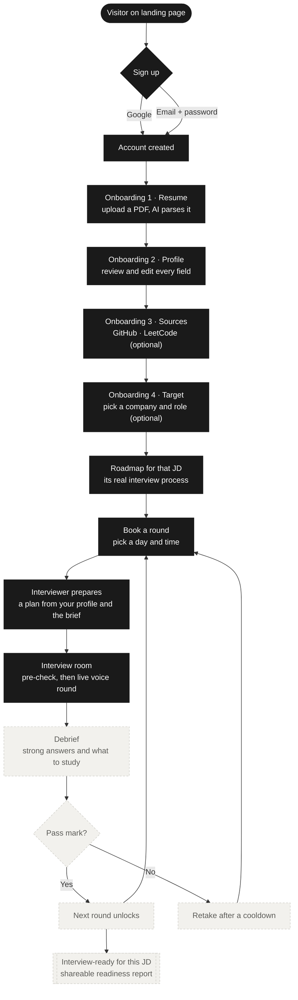
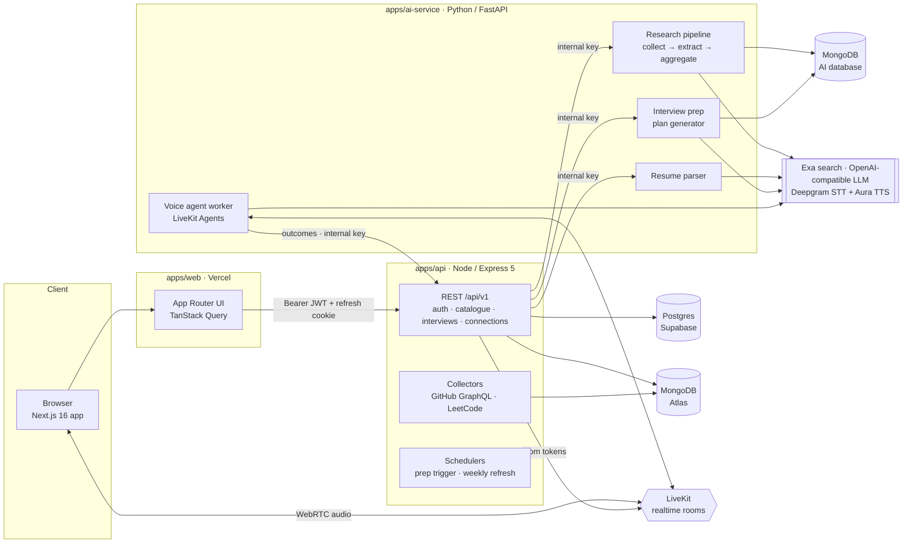
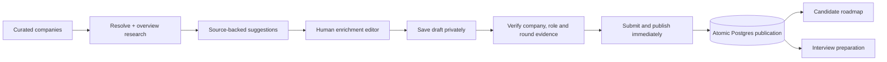
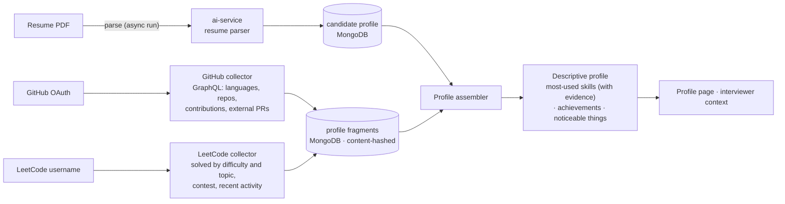
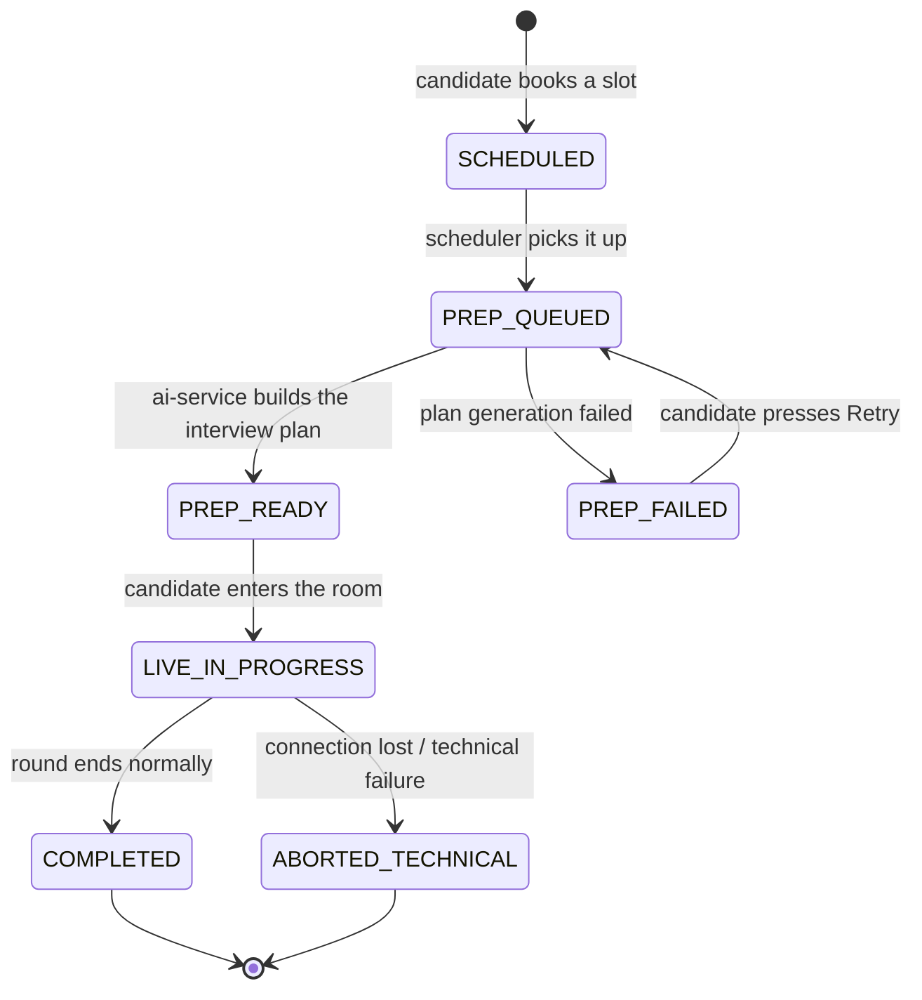
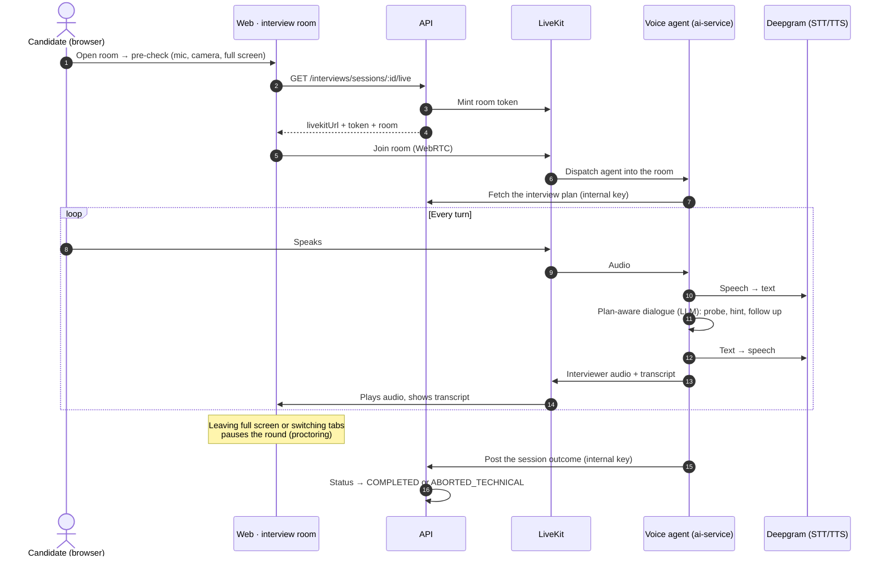
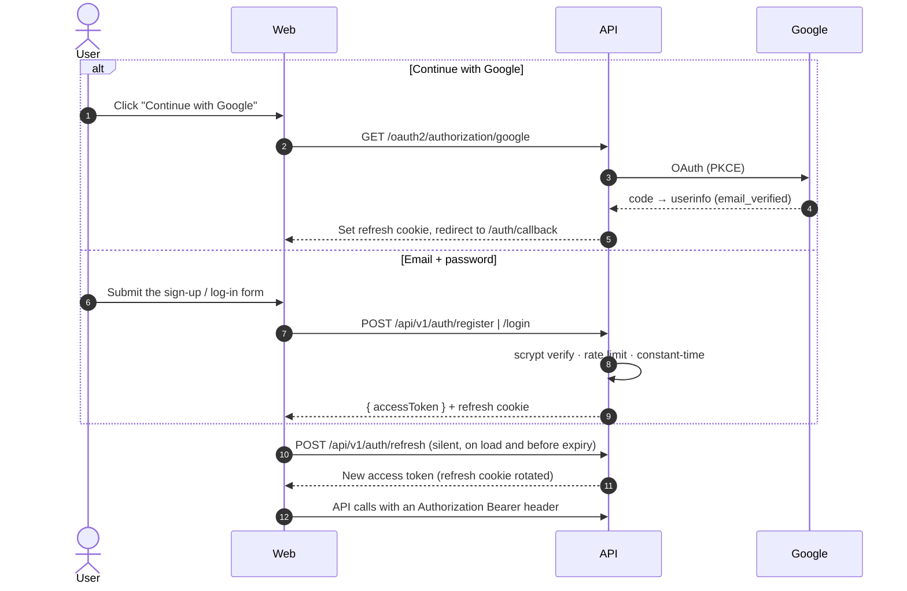
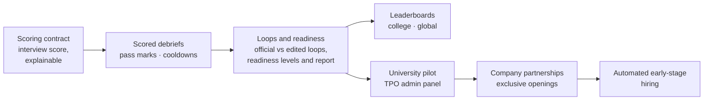

<div align="center">

# interviewIQ

**Rehearse the interview you're actually walking into.**

An AI interviewer that knows your resume and your target company's real interview process.
You practise round by round, out loud, and get a debrief after every round.

`Next.js 16` · `Node 22 / Express 5` · `Python / FastAPI` · `LiveKit + Deepgram` · `Postgres (Supabase)` · `MongoDB (Atlas)`

</div>

---

## Contents

1. [What is InterviewIQ?](#what-is-interviewiq)
2. [The product at a glance](#the-product-at-a-glance)
3. [The user journey](#the-user-journey)
4. [How it works](#how-it-works)
   - [System architecture](#system-architecture)
   - [Company research pipeline](#company-research-pipeline)
   - [Profile builder](#profile-builder)
   - [Interview session lifecycle](#interview-session-lifecycle)
   - [Live interview: what happens in the room](#live-interview-what-happens-in-the-room)
   - [Authentication](#authentication)
5. [Tech stack](#tech-stack)
6. [Repository layout](#repository-layout)
7. [Getting started](#getting-started)
8. [Day-to-day commands](#day-to-day-commands)
9. [Design system](#design-system)
10. [Product rules we never break](#product-rules-we-never-break)
11. [Roadmap and next plans](#roadmap-and-next-plans)
12. [Contributing](#contributing)

---

## What is InterviewIQ?

**The problem.** Real interview practice is scarce, expensive and inconsistent. Peer platforms
(Pramp, Interviewing.io) depend on who you get matched with. LeetCode is solo and never asks
you a follow-up. Students at Tier 2/3 colleges rarely get to rehearse the actual process of the
companies visiting their campus.

**The solution.** InterviewIQ runs a **voice-based mock interview** with an AI interviewer that
has full context on you and on the job:

- **It knows the company.** A research pipeline turns interview experiences candidates share
  across the web into one round-by-round process per company, role and level: the rounds, the
  topics, the difficulty, the interviewer's style and the red flags.
- **It knows you.** It reads your resume, GitHub and LeetCode, then asks about *your* projects,
  so there's nothing to memorise.
- **It behaves like a real interviewer.** It speaks and listens, reads your code and whiteboard,
  gives hints when you're stuck and harder follow-ups when you're flying, and runs proctored in
  full screen.
- **It tells you exactly what to fix.** Every round is designed to end in a debrief. It will
  show what you said, what a strong answer would have been, and what to study next.

**Who it's for.**

| Audience | What they get |
| --- | --- |
| 🎓 **Students** (first market: Tier 2/3 Indian engineering colleges) | Rehearse the exact process of the companies coming to campus |
| 🏛️ **Placement cells (TPOs)** | Unlimited realistic practice for the whole batch, and readiness at a glance |
| 💼 **Working professionals** | Focused, company-specific mock interviews that fit a working week |
| 🏢 **Companies** *(later)* | A shortlist of candidates who have already cleared their mock process |

**Go-to-market, in phases:** universities (B2B, through TPOs), then a public launch (B2C) in
parallel, then company partnerships with exclusive openings, then automated early-stage hiring.

---

## The product at a glance

| Surface | Route | What it does | Status |
| --- | --- | --- | --- |
| **Landing** | `/` | Marketing site: research, interview, debrief, readiness, universities, FAQ | ✅ Built |
| **Sign up / Log in** | `/signup`, `/login` | Google or email + password; also forgot and reset password, and email verification | ✅ Built |
| **Onboarding** | `/onboarding` | 4 steps: **Resume → Profile → Sources → Target**, with a live profile preview | ✅ Built |
| **Dashboard** | `/dashboard` | Up next, readiness, score tiles, recent interviews, leaderboard | ✅ Built (scores are *coming soon*) |
| **Companies** | `/jobs` | Company library with each company's data depth and live or researching status | ✅ Built |
| **Roadmap** | `/jobs/[id]` | A JD's real interview process, round by round, plus insights; book any round | ✅ Built |
| **Interviews** | `/interviews` | Book a round (day and time chips), see upcoming and past sessions | ✅ Built |
| **Interview room** | `/interviews/[id]/live` | Pre-check, then a proctored voice interview with a code editor and whiteboard | ✅ Built (beta) |
| **Debrief** | `/interviews/[id]/report` | Layout ready; needs the scoring contract | 🟡 Placeholder |
| **Profile** | `/profile` | Identity, resume, connected sources, and a descriptive summary of your work | ✅ Built |
| **Connections** | `/connections` | Connect GitHub (OAuth), LeetCode (username) and your resume (PDF) | ✅ Built |
| **Share experience** | `/experiences` | Contribute your own interview experience to the research pipeline | ✅ Built |
| **Intelligence** | `/intelligence` | **Admin** console: ingestion, catalogue, access, question bank, test benches, agent diagnostics | ✅ Built |
| **University admin** | `/admin/*` | TPO dashboard, student roster, placement drives | ⏳ Planned |

Signed-in pages live in one **app shell**. A top bar holds ⌘K search, the theme toggle,
notifications and your avatar. The page sits in a rounded card, and the **menu is revealed
behind the card**: press the 4-dot button or `M` to open it, and `Esc` to close it.

---

## The user journey



> **Dark boxes are built today.** Dashed boxes depend on the **scoring contract**, which is the
> next major milestone: scored debriefs, pass marks, retake cooldowns, readiness levels and the
> readiness report.

**Two guardrails shape the journey:**

- **Only the official process counts.** You can edit a loop's rounds, but an edited loop becomes
  standalone practice. It still gets full analysis, but it never moves your readiness.
- **Readiness, not badges.** Readiness moves through *Getting started → Progressing → Nearly
  ready → Interview-ready*. It's always framed as *mock-interview readiness* (for example
  "Interview-ready · Meesho SDE I mock process"), never as "Cleared Meesho" or "Meesho certified".

---

## How it works

### System architecture

Three apps and one contract, in a pnpm + Turborepo monorepo. Each app deploys independently.



| Piece | Responsibility | Why it's separate |
| --- | --- | --- |
| **`apps/web`** | Every screen: landing, auth, onboarding, app, admin | A pure client of the API. Server Components by default |
| **`apps/api`** | Domain logic, persistence, auth, OAuth, collectors, session orchestration | Owns the data and every rule, e.g. gating is enforced server-side |
| **`apps/ai-service`** | **All** LLM work: briefs, resume parsing, interview plans, the live voice agent | Python ecosystem, and we can swap LLM providers without touching the API |
| **`packages/contracts`** | `openapi.yaml`, the source of truth between the apps | The web app **generates** its types from it and never hand-writes DTOs |

### Company research pipeline

**Current workflow (2026-10-03): overview automation, human-owned detail.** The background job
resolves the company and researches its overview only. Detailed compensation, culture, role/JD
profiles and interview rounds are manually researched, edited and verified in Intelligence.



- **Open the editor:** Intelligence → Companies → **Enrich company**. This is admin-only; a role
  profile means a company's job/level, not a candidate's personal profile.
- **Start from collected information:** new enrichment drafts prefill available research facts,
  existing JDs and supported interview rounds, with sources and verification unchecked. Saved
  drafts are never refreshed over human edits. For an existing draft, save your edits and choose
  **Fill missing from research** to import into blank, unverified fields without publishing.
  Incomplete round evidence remains a quoted reference until a reviewer supplies missing details.
- **React Flow rounds:** add, edit, remove and reorder a linear sequence. Up/down controls persist
  order; canvas dragging only changes the visual layout. There are no branching or scoring rules.
- **Immediate publication:** Save draft is private. Submit & publish requires explicit verification
  and evidence URLs for the company, each role and each round, then publishes without another approval.
- **Preserve work:** optimistic revisions prevent overwrites. Automated refreshes cannot overwrite
  manually published content. Existing JD identities remain stable; new identities require new roles.
- **One source of truth:** candidate detail and interview preparation use the same published brief.
  Historical AI briefs remain available for legacy JDs. Scheduled detailed scraping/backfill is disabled.
- **Database setup:** migration `apps/api/drizzle/0003_supreme_grandmaster.sql` adds enrichment and
  manual brief storage; apply with the existing migration command before using the editor. It was
  generated and tested locally, not applied to your configured database during implementation.

### Profile builder

The interviewer is personal because it reads *your* work. Every source is **additive and
optional**, and a resume alone is enough to start.



- **Descriptive, never comparative.** We write "412 problems solved (78 Easy, 268 Medium, 66
  Hard)", never "an above-average solver".
- **Every claim carries evidence.** Each skill names the sources behind it (for example "GitHub
  52%, LeetCode preferred, resume claimed"), and each achievement names its source.
- **Hash-based change detection.** A fragment is only rebuilt when its source data actually
  changed.

### Interview session lifecycle

A booked round moves through these states. The API enforces every transition atomically
(compare-and-set), so running several API replicas is safe.



The **interview plan** is built from three inputs: the company brief (rounds, topics, difficulty,
style), your profile (projects, skills, LeetCode topics), and a question bank collected from
public sources. That's why the interviewer can say *"Your order-tracking service uses a queue.
Why not write straight to the database?"*

### Live interview: what happens in the room



### Authentication

Auth is **owned by the backend**: no NextAuth or Clerk. The browser holds a 15-minute access
token **in memory only**, plus an httpOnly refresh cookie scoped to `/api/v1/auth` that rotates
on every refresh.



- **Passwords** use `scrypt` from `node:crypto` (OWASP parameters, a salt per user,
  constant-time compare). A wrong password, an unknown email and a Google-only account all get
  the same "Incorrect email or password", and take the same time, so nobody can probe which
  emails exist.
- **Verification and reset links** are single-use and expire in 24 hours and 1 hour. A reset
  revokes every session. Until a mail provider is chosen, links are **printed in the API
  console**.
- **Google claims the email.** If a Google sign-in matches an unverified password account, it
  links to that account and removes the password, so nobody can pre-register your address.
- **Rate limits** apply to login, sign-up, forgot-password and resend-verification.

---

## Tech stack

| Layer | Choices |
| --- | --- |
| **Web** | Next.js 16 (App Router) · React 19 · TypeScript · Tailwind CSS 3.4 · shadcn/ui · Geist fonts · TanStack Query v5 · react-hook-form + zod · next-themes · Monaco (code) · Excalidraw (whiteboard) · @xyflow/react (agent pipeline) · LiveKit client |
| **API** | Node.js 22 · Express 5 · TypeScript (ESM) · Drizzle ORM + node-postgres · MongoDB native driver · jose (HS256 JWT) · zod config · pino logs · livekit-server-sdk |
| **AI service** | Python 3.11 · FastAPI · Motor (async Mongo) · OpenAI-compatible LLM client · Exa search · LiveKit Agents · Deepgram STT and Aura TTS |
| **Data** | Postgres on **Supabase** (users, auth tokens, companies, JDs, sessions, connections) · MongoDB **Atlas** (candidate profiles, profile fragments, session outcomes; the AI service has its own database) |
| **Contracts** | OpenAPI 3 (`packages/contracts/openapi.yaml`) → `openapi-typescript` |
| **Testing** | Vitest + Testing Library (web) · Vitest + supertest on in-process **PGlite** and **mongodb-memory-server** (API, no Docker needed) · pytest (AI service) |
| **Tooling** | pnpm 10 workspaces · Turborepo · ESLint · Docker Compose for the local stack |
| **Planned infra** | Vercel (web) · Railway / Fly (API, AI service) · Cloudflare · Sentry · PostHog |

---

## Repository layout

```text
interviewiq/
├── apps/
│   ├── web/                    Next.js 16 frontend                          :3000
│   │   ├── app/(marketing)/    landing + marketing pages
│   │   ├── app/(auth)/         sign up, log in, forgot/reset password, verify email
│   │   ├── app/(onboarding)/   the 4-step onboarding (no sidebar)
│   │   ├── app/(app)/          signed-in app: dashboard, jobs, interviews, profile, …
│   │   ├── components/         ui/ (shadcn) · patterns/ · layout/ (app shell) · visualizations/
│   │   ├── features/           cross-route feature logic: hooks, api, types
│   │   └── lib/                api client (+ generated types), auth, analytics, utils
│   ├── api/                    Node / Express 5 API                          :8080
│   │   ├── src/routes/         one router per area (auth, catalogue, interviews, …)
│   │   ├── src/services/       domain services (sessions, prep, profile assembly, …)
│   │   ├── src/integrations/   ai-service client · GitHub · LeetCode · LiveKit
│   │   ├── src/auth/           JWT · refresh tokens · Google OAuth · password auth · mailer
│   │   ├── src/db/             Drizzle schema (Postgres) · Mongo collections
│   │   ├── drizzle/            SQL migrations (applied at startup)
│   │   └── test/               Vitest suites on PGlite + in-memory Mongo
│   └── ai-service/             Python FastAPI · all LLM logic                 :8000
│       ├── app/jobs/           brief generation, question collection, scheduler
│       ├── app/interview_prep/ interview-plan generation
│       ├── app/interview_agent/ LiveKit voice agent (worker, dialogue graph, pacing)
│       └── app/resume/         resume parsing
├── packages/contracts/         openapi.yaml: the web ↔ api ↔ ai-service contract
├── infra/                      docker-compose (local stack) + env template
└── docs/                       product overview
```

---

## Getting started

### 1. Prerequisites

| Tool | Version |
| --- | --- |
| Node.js | **22.12+** |
| pnpm | **10** (`corepack enable` picks up the pinned version) |
| Python | **3.11+** |
| Databases | **Either** Docker (local Postgres + Mongo) **or** a Supabase project plus a MongoDB Atlas cluster |
| Optional | A LiveKit project and a Deepgram key (live voice interviews), an Exa key (research), and any OpenAI-compatible LLM endpoint |

### 2. Install

```bash
git clone https://github.com/DeepanshuTyagi2004/interviewiq.git
cd interviewiq
pnpm install
pnpm --filter @interviewiq/ai-service setup     # one-time Python venv (apps/ai-service/.venv)
```

### 3. Environment files

Env files are **never committed**; copy the examples and fill them in.

```bash
cp apps/api/.env.example        apps/api/.env
cp apps/web/.env.example        apps/web/.env.local
cp apps/ai-service/.env.example apps/ai-service/.env
cp infra/.env.example           infra/.env          # only for the all-in-Docker stack
```

The variables that matter most:

| App | Variable | What it's for |
| --- | --- | --- |
| api | `DATABASE_URL` | Postgres: local Docker, or Supabase (TLS is switched on automatically for Supabase hosts) |
| api | `MONGODB_URI`, `MONGODB_DATABASE` | MongoDB: local Docker, or Atlas |
| api | `JWT_SECRET` | Signs access tokens (at least 32 bytes) |
| api | `GOOGLE_CLIENT_ID`, `GOOGLE_CLIENT_SECRET` | Google sign-in. Redirect URI: `{API_PUBLIC_URL}/login/oauth2/code/google` |
| api | `FRONTEND_URL`, `API_PUBLIC_URL` | Must point at each other (CORS, OAuth redirects, email links) |
| api | `ADMIN_EMAILS` | Comma-separated emails promoted to **ADMIN** on sign-in; these accounts see Intelligence |
| api | `GITHUB_OAUTH_CLIENT_ID/SECRET`, `GITHUB_TOKEN_KEY` | Connect GitHub. GitHub tokens are AES-256-GCM encrypted at rest |
| api + ai | `INTERNAL_API_KEY` | Shared secret for API ↔ AI-service calls (**same value in both**) |
| api + ai | `LIVEKIT_URL`, `LIVEKIT_API_KEY`, `LIVEKIT_API_SECRET` | Live interview rooms |
| ai | `LLM_BASE_URL`, `LLM_API_KEY`, `LLM_MODEL_NAME` | Any OpenAI-compatible endpoint |
| ai | `EXA_API_KEY` | Web search for the research pipeline |
| ai | `MONGODB_URL`, `MONGODB_DB` | The AI service's own Mongo database |
| web | `NEXT_PUBLIC_API_URL` | API origin, e.g. `http://localhost:8080` |

### 4. Databases

**Option A, local containers:**

```bash
pnpm db:up            # Postgres 16 + Mongo 7 via infra/docker-compose.yml
```

**Option B, managed (no Docker):** set `DATABASE_URL` to your Supabase connection string and the
Mongo URIs to your Atlas cluster. Nothing else changes.

Postgres migrations in `apps/api/drizzle/` are **applied automatically when the API starts**.
To run them on their own: `pnpm db:migrate`.

### 5. Run

```bash
pnpm dev              # web :3000 + api :8080 + ai-service :8000, via Turborepo
```

To run live voice interviews, start the LiveKit agent worker in a second terminal:

```bash
cd apps/ai-service
.venv/bin/python -m app.interview_agent.worker dev
```

| Check | URL |
| --- | --- |
| Web | <http://localhost:3000> |
| API health | <http://localhost:8080/api/v1/main/healthcheck> |
| AI service health | <http://localhost:8000/health> |

Or run everything in containers with `pnpm stack:up`, which uses `infra/.env`.

### 6. First run

1. Sign up at `/signup` with an email listed in `ADMIN_EMAILS`. That account becomes an admin.
2. In development, the **email verification link is printed in the API console**. Open it to
   confirm your address.
3. Open the menu (`M`), go to **Intelligence → Companies & JDs → Load starter companies** to
   seed the catalogue, then go to **Live ingestion → Run** to generate research briefs.
4. Finish onboarding, pick a role on **Companies**, and book your first round.

---

## Day-to-day commands

```bash
pnpm dev                   # all apps in watch mode
pnpm test                  # every app's test suite (API tests need no Docker)
pnpm typecheck             # TypeScript across the workspace
pnpm lint                  # ESLint
pnpm build                 # production builds
pnpm db:migrate            # apply the API's Postgres migrations
pnpm contracts:types       # regenerate web types from packages/contracts/openapi.yaml

pnpm --filter @interviewiq/api db:generate     # new migration after editing src/db/pg/schema.ts
pnpm --filter @interviewiq/web test            # one app only
```

---

## Design system

The UI is built from a **Claude Design** export that covers the marketing site, auth and
onboarding, and the app shell with its screens. The export is kept locally, outside the repo.

| Token | Use |
| --- | --- |
| `frame` | The warm grey page frame behind every card |
| `card` / `panel` | White cards, and the soft fills that white cards float on |
| `line-1…4` | Hairline borders, lightest to darkest |
| `faint` / `muted-foreground` | Secondary and tertiary text |
| `brand` (`#ff5c1f`) | **The one accent.** Primary CTAs, the logo's third bar, active states and key pills, used sparingly |
| `inv` | The always-dark surface (up-next card, transcripts, logs) |

Shared building blocks: `.iq-eyebrow` (mono section label), `<MonoPill>`, `<Panel>`,
`.iq-float`, `<PageHeader>`, `<Logo>`, `<ThemeToggle>`, `<Waveform>`. The type is Geist and Geist Mono with
light, tightly tracked headings. Light is the default theme, and dark mode is fully supported.
Every page is built for **375px phones, iPads (768 and 1024px) and desktop**, and respects
`prefers-reduced-motion`.

---

## Product rules we never break

1. **No invented data.** If the backend doesn't have it, the UI says so ("—", "Not scored yet",
   "coming soon"). We never show sample numbers, and never show a control that doesn't work.
2. **The profile summary describes and never ranks.** Scores live in a **separate scoring
   contract**, never inside the profile summary.
3. **Every skill carries evidence, and every achievement carries a source.**
4. **Scores must be explainable.** Every future score traces back to its inputs.
5. **Gating is server-enforced.** Pass marks, cooldowns and unlocks live in the API; the UI only
   reflects them.
6. **Readiness is never a badge or certificate,** and never worded as if the company endorsed it.
7. **Sources are additive, never required.** A resume alone gives a useful profile.

---

## Roadmap and next plans

### MVP modules

| # | Module | Status | What's next |
| --- | --- | --- | --- |
| 1 | **Profile Builder** | ✅ Resume, GitHub and LeetCode collectors, descriptive profile | LLM-written profile summary (prompt under review); LinkedIn / Codeforces / HackerRank (V2) |
| 2 | **Job & Loop Setup** | ✅ Catalogue, research briefs, roadmap | Per-JD **loop dashboard**; editable rounds (an edited loop is standalone) |
| 3 | **Live Interview Session** | ✅ Booking, plan prep, LiveKit voice room, proctoring | Live signals during the round; hint requests; code-aware follow-ups |
| 4 | **Post-Interview Report** | 🟡 Layout ready | **Scoring contract**: per-question breakdown, strong answers, learn-next, pass mark → unlock or cooldown |
| 5 | **University Admin Panel** | ⏳ Planned | TPO dashboard, batch roster, bulk upload, placement drives |
| 6 | **Platform Essentials** | ✅ Google and email/password auth | Mail provider, notifications, settings, billing (Razorpay) |

### Next milestones



### Open decisions (owner: product)

- **Scoring:** the interview-score formula, pass thresholds, retake cooldown
  (1 or 2 weeks), readiness-level mapping, leaderboard rules, and what ships in the MVP.
- **LeetCode sourcing:** scraping, paste-in, or an unofficial API.
- **Voice pipeline:** stay on Deepgram + an OpenAI-compatible LLM, or move to a realtime speech
  model (cost against latency).
- **Background jobs:** in-process schedulers today, or a real queue once it hurts.

### Known gaps before real users

- Pick an **email provider**. Verification and reset links are console-only today.
- Set Express `trust proxy` behind the hosting proxy, so rate limits see real client IPs.
- Let the debrief show real facts (duration, how the round ended) by exposing them in the
  session contract.

---

## Contributing

- **Contract first.** Change `packages/contracts/openapi.yaml`, then run `pnpm contracts:types`.
  Never hand-write types that mirror API DTOs.
- **Keep logic where it belongs.** LLM work goes in `apps/ai-service`, rules and persistence in
  `apps/api`, presentation in `apps/web`.
- **Web conventions:** Server Components by default; route-specific UI in `_components/`;
  cross-route logic in `features/<name>/`; tokens and shared primitives over raw colours.
- **Tests come with changes.** API tests run in-process (PGlite + in-memory Mongo), so
  `pnpm test` needs no Docker.
- **Commits** follow Conventional Commits (`feat(web): …`, `fix(api): …`, `docs: …`).

Deeper, area-specific guides live in [`CLAUDE.md`](./CLAUDE.md),
[`apps/web/CLAUDE.md`](./apps/web/CLAUDE.md), [`apps/api/CLAUDE.md`](./apps/api/CLAUDE.md) and
[`docs/PROJECT_OVERVIEW.md`](./docs/PROJECT_OVERVIEW.md).
