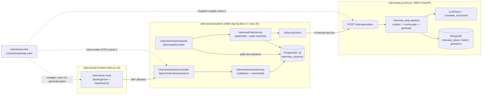
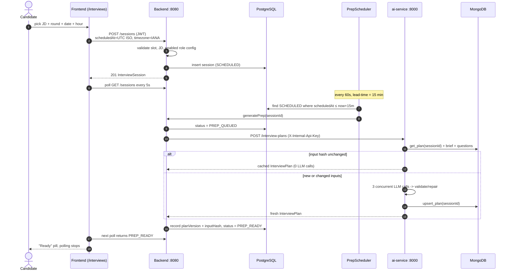
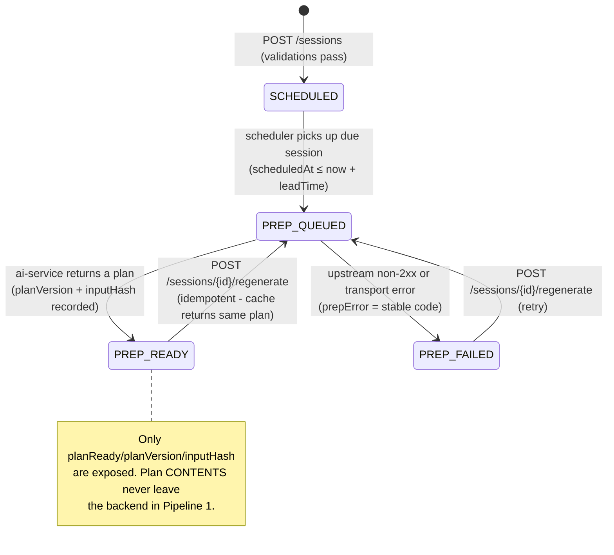
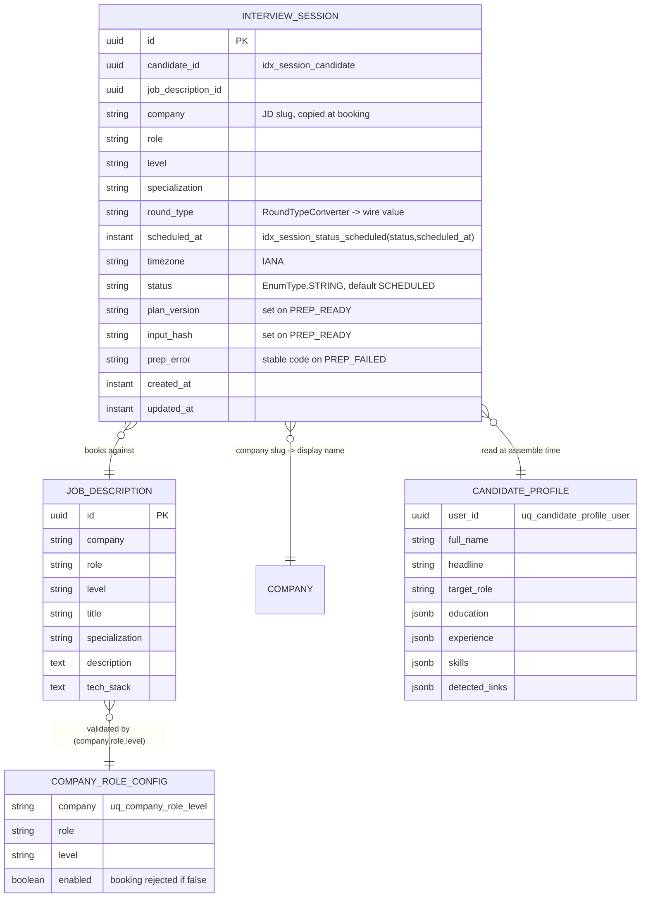
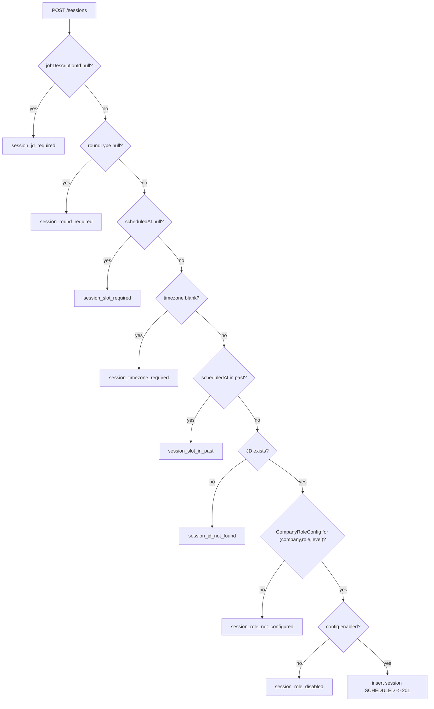
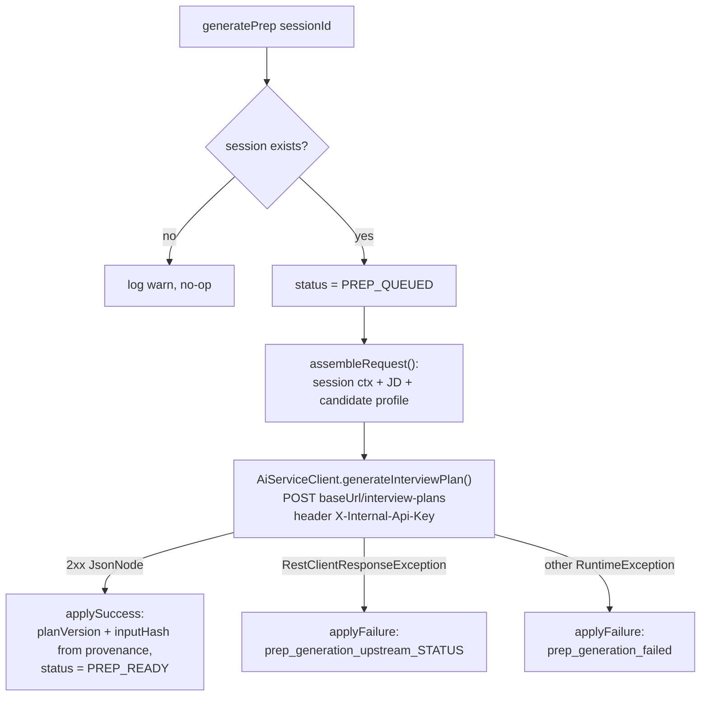
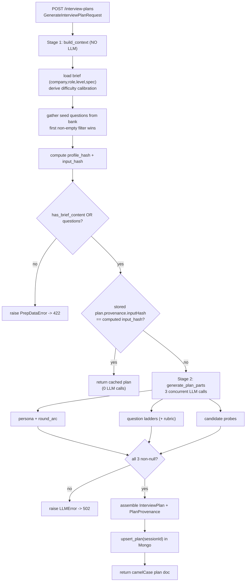
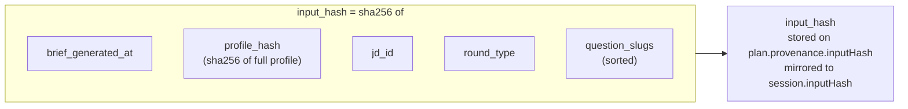
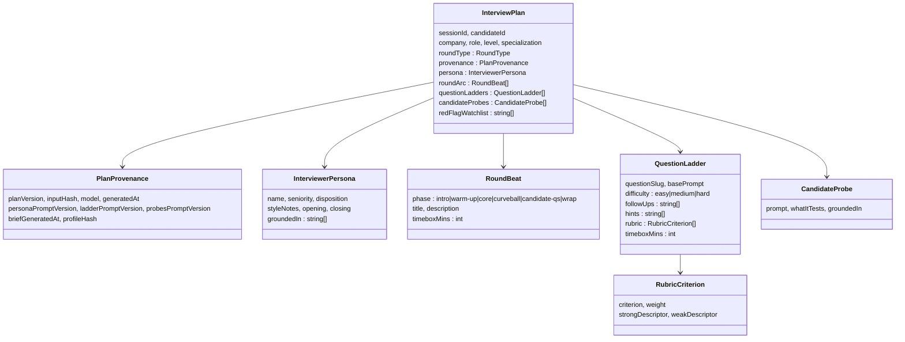
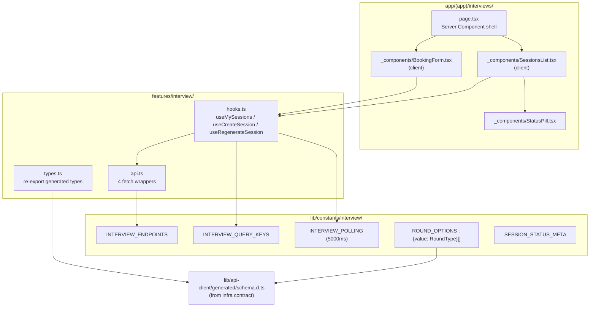

# Interview Prep (Pipeline 1) — HLD & LLD

> **Status:** Code-complete across all 4 repos · backend compiles on JDK 25 · 24 Pipeline-1 backend tests green · not yet committed · LLM prompt bodies are `v0-scaffold` placeholders (real interviewer text is product IP) · no live end-to-end run yet.
>
> **Scope:** Pipeline 1 = **prep only**. A candidate books a session (JD + round + slot); a scheduled backend job asks the ai-service to build an `InterviewPlan` before the slot; the session flips to a readiness status. There is **no live voice loop and no post-interview scoring/debrief** — those are later pipelines. `SessionStatus` is intentionally extensible for them.

This document is a map of *what is actually implemented*. Every field name, endpoint, and transition below was read from source, not from memory.

---

## 0. How to read this

- **Part I — HLD**: the shape of the system — repos, boundaries, end-to-end data flow, the happy-path sequence, and the session lifecycle.
- **Part II — LLD**: the internals of each repo — entities, endpoints, the scheduler, the ai-service pipeline, the cache gate, the frontend feature module, the contract.
- **Part III**: what is done vs. what is deliberately stubbed, plus a per-repo file index.

Diagrams are Mermaid (render inline in VS Code preview and on GitHub).

**The four repos and two trust boundaries:**

| Repo | Role | Port | Auth in |
|---|---|---|---|
| `interviewIQ-frontend` | Next.js 16 UI (student app) | — | holds JWT access token |
| `interviewiq-backend` | Spring Boot 4 / Java 25 — domain, persistence, orchestration | 8080 | **JWT** (candidate) |
| `interviewiq-ai-service` | Python FastAPI — LLM plan generation | 8000 | **`X-Internal-Api-Key`** (internal) |
| `interviewiq-infra` | `contracts/openapi.yaml` — source-of-truth contract | — | — |

---

# Part I — High-Level Design

## 1. What Pipeline 1 does

```
Candidate books an interview   →   Backend stores a SCHEDULED session
        →   A poller, N minutes before the slot, asks the ai-service to build a plan
        →   ai-service assembles context (company brief + résumé profile + JD + question bank),
            calls the LLM 3× to produce persona + question ladders + candidate probes,
            and returns an InterviewPlan
        →   Session flips to PREP_READY (or PREP_FAILED)
        →   The UI polls and shows readiness — never the plan contents.
```

**In scope:** booking, validation, the scheduled trigger, plan generation, cache-based idempotency, prep-status UI, manual retry.
**Out of scope (later pipelines):** the live interview, transcription/voice, scoring, the post-interview report. The interviewer-facing plan is generated and stored but is **never shown to the candidate** — the API only surfaces `planReady`.

## 2. System context



The contract is the single source of truth for both boundaries. The frontend **generates** its types from it (`openapi-typescript`); the backend and ai-service **hand-write** DTOs / Pydantic models that mirror it (no codegen on the server side — an intentional convention).

## 3. End-to-end data flow (narrative)

1. **Book.** The candidate picks a job description, a round type, a date, and an hour (local). The browser converts the slot to an absolute UTC ISO-8601 instant and sends its IANA timezone alongside. `POST /api/v1/interviews/sessions`.
2. **Validate + persist.** The backend validates the request imperatively (JD exists, JD maps to an *enabled* `CompanyRoleConfig`, slot is not in the past), copies `company/role/level/specialization` from the JD onto the session, and stores it as `SCHEDULED`. **No prep happens synchronously** — the response returns immediately.
3. **Trigger.** A Spring `@Scheduled` poller runs every 60s. It selects `SCHEDULED` sessions whose slot is within the lead-time window (`scheduledAt <= now + 15min`) and drives each through prep.
4. **Assemble.** For each due session the backend flips it to `PREP_QUEUED`, then assembles the ai-service request from the session context, the JD, and the candidate profile (via `CandidateProfileService`). A missing profile is tolerated — an empty profile is sent.
5. **Generate.** The ai-service builds a grounding context (company brief + difficulty calibration + seed questions from the bank), computes a fused **input hash**, and — if a stored plan already matches that hash — returns it with **zero LLM calls**. Otherwise it runs three concurrent, schema-validated LLM calls (persona+arc, question ladders, candidate probes), assembles the `InterviewPlan`, stores it in Mongo keyed by `sessionId`, and returns it.
6. **Settle.** The backend reads `provenance.planVersion` and `provenance.inputHash` off the returned plan, records them on the session, and flips it to `PREP_READY`. Any upstream/transport failure flips it to `PREP_FAILED` with a stable error code.
7. **Reflect.** The UI polls the session list every 5s while anything is `SCHEDULED`/`PREP_QUEUED`, and stops once everything is `PREP_READY`/`PREP_FAILED`. A failed session shows a **Retry** button that re-queues prep.

## 4. Happy-path sequence



## 5. Session lifecycle (state machine)



`SessionStatus` has exactly four values today: `SCHEDULED`, `PREP_QUEUED`, `PREP_READY`, `PREP_FAILED`. Future live/debrief states (e.g. `LIVE_IN_PROGRESS`, `DEBRIEF_READY`) are anticipated but **not** in the enum yet.

---

# Part II — Low-Level Design

## 6. Backend (`interviewiq-backend`)

### 6.1 Persistence / entity relationships



**Table `interview_sessions`** carries two indexes that matter:
- `idx_session_candidate (candidate_id)` — the dashboard list query.
- `idx_session_status_scheduled (status, scheduled_at)` — the poller's due-set query.

`round_type` is persisted by its **wire value** (`"system-design"`, not `SYSTEM_DESIGN`) via `RoundTypeConverter`. `status` is persisted as the enum name (`@Enumerated(EnumType.STRING)`).

### 6.2 REST API surface — `InterviewSessionController`

Base path `/api/v1/interviews` (Spring MVC API versioning: `@RequestMapping(version = "1")` + `spring.mvc.apiversion.use.path-segment=1`). All handlers read the candidate id from `jwt.getSubject()`; **ownership is enforced in the service** (a non-owner gets `404`, never `403`).

| Verb | Path | Body | Success | Notes |
|---|---|---|---|---|
| POST | `/sessions` | `CreateInterviewSessionRequest` | `201` `InterviewSession` | validates + persists as `SCHEDULED` |
| GET | `/sessions` | — | `200` `InterviewSessionListResponse` | newest slot first, candidate-scoped |
| GET | `/sessions/{sessionId}` | — | `200` `InterviewSession` | owner-only |
| POST | `/sessions/{sessionId}/regenerate` | — | `202` `InterviewSession` | owner-only; re-queues prep |

Errors are returned as a stable `{ code, message }` envelope (`ApiError`) via a controller-local `@ExceptionHandler`. `InterviewSessionException` carries both the HTTP status and the code.

`CreateInterviewSessionRequest` is `record(UUID jobDescriptionId, RoundType roundType, Instant scheduledAt, String timezone)` — **no** JSR-380 annotations; all validation is imperative (see 6.3). The response record `InterviewSessionResponse` exposes `planReady/planVersion/inputHash/prepError` but **never the plan body**.

### 6.3 Session-creation validation (`InterviewSessionService.createSession`)

Executed in order; each failure throws `InterviewSessionException.badRequest(code, message)` → HTTP 400:



The JD → `CompanyRoleConfig` check (`findByCompanyAndRoleAndLevel`) is what ties booking to the *configured, enabled* interview targets — you can only book rounds the platform is set up to prep for.

### 6.4 The trigger — `InterviewPrepScheduler`

```java
@Scheduled(
  fixedDelayString  = "${interviewprep.poll-interval-ms:60000}",
  initialDelayString = "${interviewprep.poll-initial-delay-ms:30000}")
```

Each tick:
1. `cutoff = now + leadTimeMinutes` (default **15 min**, `interviewprep.lead-time-minutes`).
2. `findByStatusAndScheduledAtLessThanEqual(SCHEDULED, cutoff)` — the due set.
3. For each, call `InterviewPrepService.generatePrep(id)`; a per-session `try/catch` isolates failures so one bad session doesn't stop the batch (`generatePrep` records `PREP_FAILED` itself).

Plain Spring `@Scheduled` (not jobrunr/Quartz) — mirrors the existing `ProfileRefreshScheduler` / `LeetCodeRefreshScheduler`. `@EnableScheduling` + `@EnableAsync` live on the application class.

### 6.5 Prep orchestration — `InterviewPrepService` + `AiServiceClient`

`generatePrep(sessionId)` runs the slow HTTP call **outside** any DB transaction; each state change is its own `save()`:



`assembleRequest` builds `GenerateInterviewPlanRequest { session, jobDescription, candidateProfile }`. The profile comes from `CandidateProfileService.getProfile(candidateId)`; when absent it sends an **empty** `PlanCandidateProfile` (profile is additive, never required). `applySuccess` reads only `provenance.planVersion` and `provenance.inputHash` off the returned plan — the plan body is not persisted backend-side.

`regenerate(candidateId, sessionId)` verifies ownership, sets `PREP_QUEUED`, clears `prepError`, then fires `generateAsync` (`@Async`, fire-and-forget) and returns `202` immediately.

`AiServiceClient` uses a shared `RestClient` bean. **Note:** no explicit connect/read timeouts are configured (JDK `HttpClient` defaults), so a slow-ai-service timeout surfaces as the generic `prep_generation_failed` code rather than an `upstream_<status>` code.

### 6.6 Stable error codes (backend)

| Code | Meaning | HTTP |
|---|---|---|
| `session_jd_required` / `session_round_required` / `session_slot_required` / `session_timezone_required` | missing field | 400 |
| `session_slot_in_past` | slot already passed | 400 |
| `session_jd_not_found` | JD id unknown | 400 |
| `session_role_not_configured` | JD has no `CompanyRoleConfig` | 400 |
| `session_role_disabled` | config exists but disabled | 400 |
| `session_not_found` | unknown **or** not owned | 404 |
| `prep_generation_upstream_<status>` | ai-service returned non-2xx (stored in `prepError`) | — |
| `prep_generation_failed` | transport/other failure (stored in `prepError`) | — |

---

## 7. AI-service (`interviewiq-ai-service`)

### 7.1 Pipeline internals — `POST /interview-plans`

Route: `app/api/routes.py`, `dependencies=[Depends(require_internal_key)]` (constant-time compare of `X-Internal-Api-Key`). `PrepDataError → 422`, `LLMError → 502`.



Each of the three LLM calls goes through `complete_structured(...)` and its own optional Langfuse span. They run concurrently under a semaphore (`gather_capped`, `prep_concurrency`). If **any** returns null, the whole plan fails (`LLMError`) — a plan needs all three parts.

### 7.2 Stage 1 context + the input hash (cache key)

`build_context` produces the grounding blob and, critically, the **fused input hash** that gates everything. The hash is `"sha256:" + sha256(json.dumps(payload, sort_keys=True))` over exactly this tuple:



Because the hash folds the brief timestamp, the profile content, the JD, the round, and the exact seed questions, **any** change to the candidate's inputs busts the cache; nothing else does. This is what makes `regenerate` cheap and idempotent.

Seed-question selection tries filters in order and takes the **first non-empty** result: `(company, difficulty)` → `(company, any)` → `(any, difficulty)` → `(any, any)`. Only thin metadata (`slug, title, url, difficulty, topic_tags`) is passed to the LLM — never full problem text.

### 7.3 Stage 2 — structured LLM generation (`app/llm/structured.py`)

`complete_structured(llm, system, user, response_model, *, max_repairs, label)` is a hand-rolled validate-and-repair loop over `LLMClient.complete_json` — **no `instructor` dependency**:

- Attempt → `model_validate`. On `ValidationError`, append a compact repair note (up to 8 error lines + the offending JSON echoed back, truncated to 2000 chars) to the prompt and re-ask.
- `max_repairs` (default 2, `PREP_MAX_REPAIRS`) means **3 total attempts**. Exhausted → raise `LLMError`. A raw `ValidationError` never escapes.
- Client key rotation, cooldowns, and JSON salvage are inherited from the existing `LLMClient`.

Observability (`app/obs/`) is an **optional** Langfuse span — a true no-op unless `LANGFUSE_ENABLED` and both keys are set; `langfuse` is not even in `requirements.txt` and is imported lazily.

### 7.4 `InterviewPlan` schema (the plan doc)

Stored in Mongo `interview_plans` (one doc per `sessionId`, unique index) as the **camelCase wire shape**. Pydantic models are camelCase-on-the-wire, snake-in-Python (`alias_generator=to_camel`).



The **rubric** (`RubricCriterion`) is interviewer-only and lives **only** on `InterviewPlan` — it is never grafted onto any `ProfileSummary`/descriptive contract. This is a hard product rule (Profile Builder is purely descriptive; evaluation lives here).

Prompts (`app/interview_prep/prompts/{persona,ladder,probes}.py`) are functional but currently `*_PROMPT_VERSION = "v0-scaffold"` placeholders — the real interviewer-voice text is product IP to be human-drafted. Each version is recorded on `provenance`, so bumping a prompt version busts nothing automatically but is traceable per plan.

### 7.5 Idempotency & failure mapping (summary)

| Situation | Result |
|---|---|
| Same inputs as stored plan | cached plan returned, **0 LLM calls** |
| No brief content **and** no questions | `PrepDataError` → 422 |
| LLM never produces all 3 valid parts | `LLMError` → 502 |
| Success | plan upserted, returned; backend records `planVersion` + `inputHash` |

---

## 8. Frontend (`interviewIQ-frontend`)

### 8.1 Feature module map



Types are **imported from the generated schema**, never hand-written (`npm run generate:types` → `tsx scripts/generate-types.ts` reads `../interviewiq-infra/contracts/openapi.yaml`). `ROUND_OPTIONS[].value` is typed to the generated `RoundType` union, so contract drift is a compile error.

### 8.2 Adaptive polling (`useMySessions`)

TanStack Query v5 `useQuery` with a functional `refetchInterval`:

```
refetchInterval = (query) =>
    query.data?.sessions?.some(s => s.status === "SCHEDULED" || s.status === "PREP_QUEUED")
        ? 5000        // still preparing → poll
        : false       // all PREP_READY / PREP_FAILED → stop
```

Booking (`useCreateSession`) and retry (`useRegenerateSession`) both `invalidateQueries(["interviews","sessions"])` on success — a successful retry flips a session back toward `PREP_QUEUED`, which **restarts** polling automatically.

### 8.3 Components

- **`BookingForm`** (client): role `<select>` from `useJds()`, round `<select>` from `ROUND_OPTIONS`, a shadcn `Popover` + `Calendar` (react-day-picker, past dates disabled), and a fixed 09:00–18:00 hour grid with **past slots disabled**. On submit it builds `slot.toISOString()` (absolute UTC) and sends `Intl.DateTimeFormat().resolvedOptions().timeZone` as the IANA `timezone`. Validation: `canSubmit` requires JD + round + date + a non-past hour.
- **`SessionsList`** (client): renders the polling query — skeletons while loading, an alert on error, an empty state, else one `SessionCard` per session. `SessionCard` shows company/round/slot + a `StatusPill`; on `PREP_FAILED` it shows a **Retry** button wired to `useRegenerateSession`.
- **`StatusPill`**: maps `SESSION_STATUS_META[status].tone` to a badge variant + lucide icon; the icon spins (`animate-spin`) only for the `pending` tone (`PREP_QUEUED`).

All timestamps are stored as UTC instants and rendered in the viewer's local zone via `toLocaleString`.

---

## 9. The contract (`interviewiq-infra/contracts/openapi.yaml`)

OpenAPI `3.0.3`, `InterviewIQ Contract` v`0.2.0` (Pipeline 1 is the 0.2.0 surface). Two security schemes: `bearerAuth` (JWT, candidate paths) and `internalApiKey` (`X-Internal-Api-Key`, the `/interview-plans` path, server overridden to `:8000`).

Key facts the code must keep matching:
- Enums are verbatim: `RoundType = [online-assessment, dsa, system-design, lld, behavioural, hiring-manager]`; `SessionStatus = [SCHEDULED, PREP_QUEUED, PREP_READY, PREP_FAILED]`; `Difficulty = [easy, medium, hard]`.
- There is **no** separate `InterviewSessionResponse` schema — single-session ops reference `InterviewSession` directly; the list is `{ sessions: InterviewSession[] }`.
- `InterviewSession` optional fields are exactly `companyName, planVersion, inputHash, prepError`.
- `InterviewPlan` requires **all** its fields; `QuestionLadder.rubric` is the only place rubric appears.

The three consumers stay in sync by convention: frontend regenerates types; backend and ai-service keep hand-written DTOs/models mirroring it. **Any schema change means touching all three** — there is no runtime enforcement.

## 10. Cross-cutting concerns

| Concern | Implementation |
|---|---|
| **Auth boundaries** | Candidate → backend: JWT Bearer, subject = candidate id. Backend → ai-service: `X-Internal-Api-Key`, constant-time compare. Ownership: 404 on non-owner (no existence leak). |
| **Idempotency** | Fused `input_hash` (brief ts + profile hash + JD id + round + sorted question slugs). Cache hit = 0 LLM calls. `regenerate` is safe to spam. |
| **Config knobs** | `interviewprep.lead-time-minutes` (15), `interviewprep.poll-interval-ms` (60000), `interviewprep.poll-initial-delay-ms` (30000), `aiservice.base-url`, `internal.api-key`; ai-service `PREP_PLAN_VERSION` (v1), `PREP_MAX_REPAIRS` (2), `PREP_CONCURRENCY`, `LLM_MODEL_NAME`, `LANGFUSE_*`. |
| **Resilience** | Scheduler isolates per-session failures; ai-service failures map to `PREP_FAILED` with stable codes; frontend surfaces failure + Retry. |
| **Descriptive-vs-evaluative rule** | Evaluation (rubric) exists **only** inside `InterviewPlan`. The candidate never sees the plan. Profile stays purely descriptive. |

---

# Part III — Status & gaps

## 11. Done & verified (2026-07-02)

- All 4 repos wired end-to-end (contract → backend → ai-service → frontend).
- Backend compiles clean on JDK 25 (`openjdk@25`).
- 24 Pipeline-1 backend tests green: `InterviewSessionControllerTest` (7), `InterviewSessionServiceTest` (9), `InterviewPrepServiceTest` (5), `InterviewPrepSchedulerTest` (3).
- Frontend: zero TypeScript/lint errors in the interview feature; types generated from the contract.

## 12. Not done / caveats

- **Uncommitted.** All backend Pipeline-1 files are still untracked in git.
- **Prompts are `v0-scaffold` placeholders.** The pipeline runs and validates, but generated plans are stub-grade until the real interviewer prompts are drafted (product IP — human-authored, then bump `*_PROMPT_VERSION`).
- **No live end-to-end run.** The path is unit-tested per repo but has not been exercised against a real Mongo + real LLM + the running backend together.
- **No explicit ai-service client timeouts** — slow-service failures land as the generic `prep_generation_failed` code.
- **Scope reminder:** live interview, transcription, scoring, and the post-interview report are later pipelines. The interviewer plan is generated but never shown to the candidate.

## 13. File index

**backend** (`src/main/java/com/interviewiq/interviewiq_backend/`)
- `models/`: `InterviewSession`, `RoundType`, `RoundTypeConverter`, `SessionStatus`, (reads `JobDescription`, `CompanyRoleConfig`, `CandidateProfile`, `Company`)
- `dtos/`: `CreateInterviewSessionRequest`, `InterviewSessionResponse`, `InterviewSessionListResponse`
- `controllers/InterviewSessionController` · `services/InterviewSessionService`, `InterviewPrepService`, `InterviewSessionException`
- `jobs/InterviewPrepScheduler` · `integrations/aiservice/{AiServiceClient, GenerateInterviewPlanRequest}`
- `repositories/InterviewSessionRepository` · `resources/application.properties`
- tests: `controllers/InterviewSessionControllerTest`, `services/{InterviewSessionServiceTest, InterviewPrepServiceTest}`, `jobs/InterviewPrepSchedulerTest`

**ai-service** (`app/`)
- `interview_prep/{schema, context, generate, pipeline}.py` + `prompts/{persona, ladder, probes}.py`
- `llm/structured.py` · `obs/{__init__, tracing}.py` · `api/{routes, deps}.py` · `db/{mongo, repositories}.py`

**frontend** (`interviewIQ-frontend/`)
- `features/interview/{types, api, hooks, index}.ts` · `lib/constants/interview/index.ts`
- `app/(app)/interviews/{page.tsx, _components/{BookingForm, SessionsList, StatusPill}.tsx}`
- `lib/api-client/generated/schema.d.ts` · `scripts/generate-types.ts`

**infra**
- `contracts/openapi.yaml` (v0.2.0)
