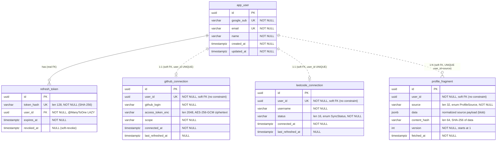
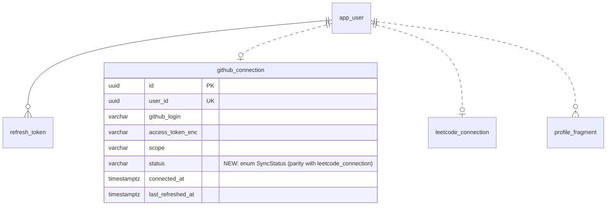

# Profile — Structure Conformance & Schema Normalization

> **Status:** Analysis + plan (2026-06-14). Read-only report; no behaviour changes implied by this document.
> **Scope:** (A) conform the `profile/` vertical slice to the repo's layer-first package convention; (B) assess and visualize the DB schema and its normalization.

---

## A. Package structure

### A.1 Established convention (everything except `profile/`)

The codebase is **layer-first** — technical layers at the package root:

| Layer | Suffix | Type | Key annotations |
|---|---|---|---|
| `config/` | none | class | `@Configuration` + `@Bean` |
| `controllers/` | `*Controller` | class | `@RestController`, `@RequestMapping("/api/{version}/…")` |
| `dtos/` | `*Response` / `*Request` | Java `record` | plain records, factory methods |
| `models/` | none | class | `@Entity`, Lombok, `@PrePersist/@PreUpdate`, `GenerationType.UUID` |
| `repositories/` | `*Repository` | interface | `extends JpaRepository`, `@Repository` |
| `services/` | `*Service` | concrete class | `@Service`, `@Transactional`, constructor injection |

Domains present today in this layout: **auth**, **user**.

### A.2 The deviation

`profile/` was built as a self-contained vertical slice:

```
profile/
  web/            ProfileController, GitHubConnectionController, LeetCodeConnectionController
    dto/          ApiError, AuthorizeUrlResponse, ConnectLeetCodeRequest, LeetCodeConnectResponse,
                  NotableItem, ProfileResponse, ProfileUser, ProvenanceItem, SkillItem, SourceStatus
  service/        ProfileService, ProfileRefreshScheduler, LeetCodeRefreshScheduler
  model/          GitHubConnection, LeetCodeConnection, ProfileFragment, ProfileSource, SyncStatus
  repository/     GitHubConnectionRepository, LeetCodeConnectionRepository, ProfileFragmentRepository
  github/         GitHubOAuthService, OAuthStateService, GitHubCollector, GitHubGraphQlResponse
  leetcode/       LeetCodeService, LeetCodeCollector, LeetCodeCollectionJob, LeetCodeProfileException
  assembler/      ProfileAssembler, RuleBasedProfileAssembler
  crypto/         TokenCipher
```

### A.3 Mapping to the convention

**Clean-mapping files (17) → move straight into existing layers:**

| Current | → Target |
|---|---|
| `profile/web/*Controller` (3) | `controllers/` |
| `profile/web/dto/*` (10 records) | `dtos/` |
| `profile/model/*` (3 entities + 2 enums) | `models/` |
| `profile/repository/*Repository` (3) | `repositories/` |
| `profile/service/ProfileService` | `services/` |

**Files with no clean home in the 6-layer convention (18):**

| Group | Files | Concern |
|---|---|---|
| GitHub integration | `GitHubOAuthService`, `OAuthStateService`, `GitHubCollector`, `GitHubGraphQlResponse` | OAuth, CSRF state, GraphQL fetch + normalize |
| LeetCode integration | `LeetCodeService`, `LeetCodeCollector`, `LeetCodeCollectionJob` (`@Async`), `LeetCodeProfileException` | validation, fetch + normalize, async worker, domain error |
| Synthesis | `ProfileAssembler`, `RuleBasedProfileAssembler` | merge fragments → UI bands |
| Crypto | `TokenCipher` | AES-256-GCM token encryption |
| Scheduling | `ProfileRefreshScheduler`, `LeetCodeRefreshScheduler` (`@Scheduled`) | weekly refresh |

**Recommended target tree** (layer-first for the clean files, plus the technical packages the convention is currently missing — avoids overloading `services/`):

```
com/interviewiq/interviewiq_backend/
  config/
  controllers/      + ProfileController, GitHubConnectionController, LeetCodeConnectionController
  dtos/             + 10 profile DTO records
  models/           + GitHubConnection, LeetCodeConnection, ProfileFragment, ProfileSource, SyncStatus
  repositories/     + GitHubConnectionRepository, LeetCodeConnectionRepository, ProfileFragmentRepository
  services/         + ProfileService
  integrations/
    github/         GitHubOAuthService, OAuthStateService, GitHubCollector, GitHubGraphQlResponse
    leetcode/       LeetCodeService, LeetCodeCollector, LeetCodeCollectionJob, LeetCodeProfileException
  jobs/             ProfileRefreshScheduler, LeetCodeRefreshScheduler
  synthesis/        ProfileAssembler, RuleBasedProfileAssembler
  crypto/           TokenCipher
```

### A.4 Why this is behaviour-neutral

Package moves change only `package`/`import` lines. Behaviour is preserved because everything that matters is explicit:

- **Component scan** — `@SpringBootApplication` at the root package scans all sub-packages; beans stay discovered. Confirmed **no** `@ComponentScan`/`@EntityScan`/`@EnableJpaRepositories` basePackages narrowing exists.
- **Endpoints** — `@RequestMapping` paths are literal → URLs unchanged.
- **Tables/columns** — `@Table`/`@Column` explicit → DB unchanged.
- **Wiring** — constructor injection by type; `@Scheduled`/`@Async`/`@Transactional` annotation-driven → unaffected by package.
- **No cycles** — profile depends on top-level `User`/`UserService`; nothing outside profile imports profile.

### A.5 Risks to handle during the move

1. **Package-private visibility** — any class/member currently package-private and used by a sibling in the same `profile/*` sub-package must be promoted to `public` once separated (the compiler flags these).
2. **Test mirror** — `src/test/java/.../profile/{crypto,assembler,leetcode,web,github,service}` (7 files) must move with the code and have imports updated.
3. Verified safe: no scan-narrowing, no path-based build config (Maven, package-based).

Verification gate: `mvn -q compile` + full `mvn test` must pass after the moves.

---

## B. Database schema

5 tables. Only `refresh_token` has a real DB foreign key; the three profile tables reference `app_user` via bare `UUID` columns (no constraint — "soft" FKs).

### B.1 Current schema (visual ERD)



> Relationship line style: `||--o{` = real DB FK; `||..o|` / `||..o{` (dotted) = application-level soft FK with **no** DB constraint.

**Enums (stored inline, `@Enumerated(STRING)`):**
- `SyncStatus` = `SYNCING | SYNCED | FAILED | DEGRADED`
- `ProfileSource` = `GITHUB | RESUME | LEETCODE | LINKEDIN | X`

**What lives inside `profile_fragment.data` (JSONB):**
- **GitHub:** `login, name, avatarUrl, joinedYear, publicRepos, contributions{lastYear, weeks[52][7]}, languages[]{name,pct,bytes}, topRepos[]{name,stars,primaryLang}, externalPRs`
- **LeetCode:** `username, country, solved{easy,medium,hard,total}, byTopic[]{topic,count}, contest{attended,rating,globalRanking,totalParticipants,topPercent}?, recentActivity{last30Days,preferredLanguage}`

### B.2 Normalization findings

| # | Finding | NF | Proposed shape | `ddl-auto` safe? | Verdict |
|---|---|---|---|---|---|
| 1 | `profile_fragment.data` holds repeating groups (languages[], topRepos[], byTopic[], contribution grid) | 1NF / queryability | Child tables per source, or typed projection; keep JSONB canonical | table-create only; **needs backfill + dual-write** | **Flag** — contradicts the *decided* source-agnostic JSONB design (CLAUDE.md) |
| 2 | Per-source connection tables duplicate lifecycle columns; **`github_connection` has no `status`** while LeetCode does | DRY/schema smell | Add `status` to `github_connection` now; longer-term a unified `source_connection` + `github_credential` satellite | **`status` add = YES** (no migration); unified table = backfill + refactor + **security (token) stop-and-ask** | **`status` add: recommended.** Table merge: flag |
| 3 | Soft FKs on all 3 profile tables (no referential integrity; orphans possible) | integrity | `@ManyToOne @JoinColumn(user_id)` / DB FK | **NO** — update mode won't add constraints to existing columns; fails on orphans | **Flag** — manual orphan-cleanup + `ALTER TABLE` |
| 4 | Derived values cached in blob (`pct`, `solved.total`, `topPercent`) | 3NF-ish | Compute on read (assembler already assembles on read), or generated columns | n/a (JSON) | Acceptable cache; document |
| 5 | No typed projection for cross-source queries (TPO/Admin cohort filters will scan JSONB) | — (consequence of 1–2) | Narrow additive read-model / summary table | **YES** + backfill | Defer until a query need appears |

### B.3 Recommended schema target (only the additive-safe change)



Adding `status` to `github_connection` is additive under `ddl-auto=update` (nullable, or a one-time default of `SYNCED` for existing rows) and requires no migration script.

### B.4 Explicitly out of scope unless overridden

These collide with CLAUDE.md decided designs / stop-and-ask rules and are **not** applied without a human decision:
- Relationalizing the JSONB fragment (Finding 1) — the JSONB-per-source design was decided ("don't relitigate").
- Unified `source_connection` + token satellite (Finding 2) — touches token storage (security stop-and-ask).
- Adding real FK constraints (Finding 3) — not additive; needs a manual migration with orphan cleanup, and there is no Flyway.

---

## C. Verification

- **Structure:** `mvn -q compile` then full `mvn test` (incl. the migrated `profile` test mirror) — all green.
- **Schema:** boot the app against a DB and confirm Hibernate adds `github_connection.status` with no error and no change to existing tables/columns; existing endpoints/responses unchanged.
